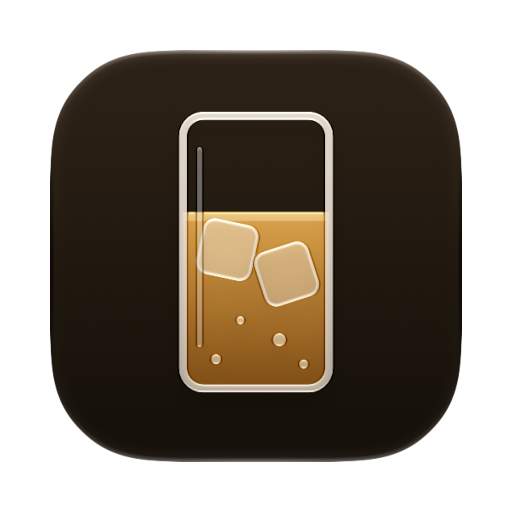
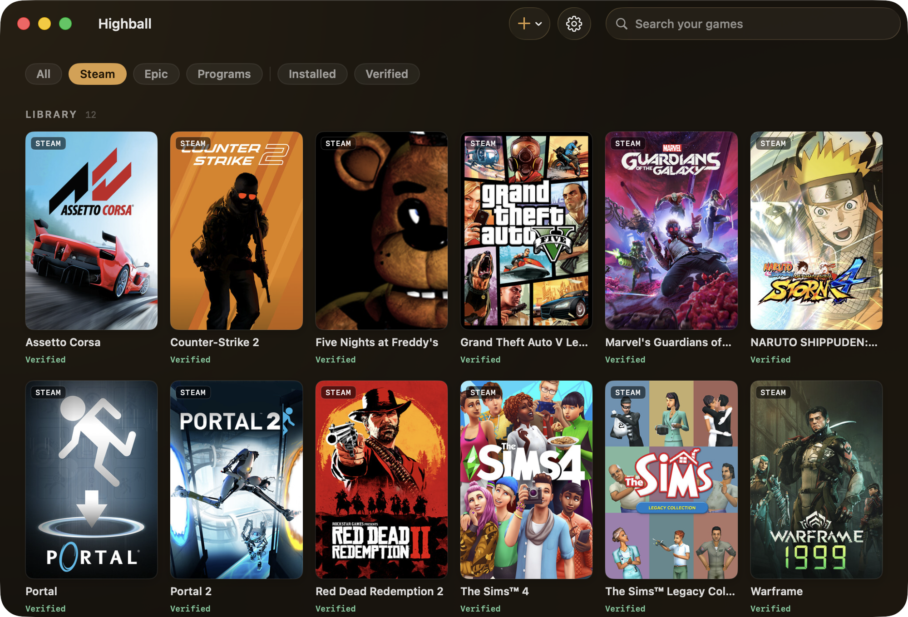

<p align="center"></p>
<h1 align="center">Highball</h1>
<p align="center"><b>在 Apple 芯片的 Mac 上运行 Windows 游戏。免费、开源，不绑定任何一个 Wine 版本。</b></p>

<p align="center"><a href="README.md">English</a> · 简体中文</p>

<p align="center">
  <a href="LICENSE"></a>
  <a href="https://github.com/gauthierpiarrette/highball/releases/latest"></a>
  <a href="https://github.com/gauthierpiarrette/highball/actions/workflows/ci.yml"></a>
  <a href="https://github.com/gauthierpiarrette/highball/stargazers"></a>
  
  <a href="https://discord.gg/WnyYpXuf67"></a>
</p>

<p align="center"></p>

Highball 是一个原生 macOS 应用（附带命令行工具）。它替你配置好 Wine、DXMT、D3DMetal 和 DXVK，安装 Steam 或连接你的 Epic 游戏库，并如实告诉你哪些游戏能玩、哪些不能，以及该用哪种图形模式。

它的不同之处在于数据。每一个结论都来自一个开放的 CC0 兼容性数据库，包括实测记录、每款游戏的图形模式结论和内核级反作弊游戏名单，每条结论都注明来源。这是一个独立的数据集，任何工具都可以在它之上构建（[highball-db](https://github.com/gauthierpiarrette/highball-db)，也可以在 [gethighball.com/database](https://gethighball.com/database/) 浏览）。所以在下载任何东西之前，你就能先查到自己的游戏能不能跑。

应用界面目前是英文的，中文界面还没有做。

## 下载

### [下载 Highball（Apple 芯片，.dmg）](https://github.com/gauthierpiarrette/highball/releases/latest/download/Highball.dmg)

需要 macOS 14 或更高版本，已通过 Apple 公证。把它拖进“应用程序”文件夹，打开后点击 Get started。Highball 会在需要时安装 Rosetta，下载引擎，准备好一个 Windows 环境，然后问你的游戏在哪里（Steam、Epic，或者你已有的某个 Windows 程序）。

也可以用 Homebrew 安装：

```sh
brew install --cask highball
```

不确定你的游戏能不能跑？**[先查兼容性数据库 →](https://gethighball.com/database/)**

> **测试版，已经可以完整使用。** 一键安装，登录 Steam，进入游戏。图形模式会根据数据库按游戏自动选择，启动使用 msync 加速，应用会自动更新。它不是付费工具，也不是一层薄薄的外壳。引擎由固定版本、经过 SHA-256 校验的上游构建组装而成，兼容性数据完全公开，任何人都可以免费复用。

## 我的游戏能跑吗？

这正是这个项目存在的意义，所以答案放在一个开放的 CC0 数据库里：经过验证的图形模式结论、玩家实际得到的帧率，以及每条结论的来源。本地实测、社区报告和机器推断分开标注，你始终知道自己看到的是哪一种。使用内核级反作弊的游戏会在你下载 80 GB 之前就被标为无法运行。

### [在数据库里搜索你的游戏 →](https://gethighball.com/database/)

举个例子，《赛博朋克 2077》在 M5 上能跑到 60 到 82 fps（D3DMetal 加 FSR 2.1）。《荒野大镖客：救赎 2》在修复了 MoltenVK 的一个问题之后可以在 M1 Pro 上游玩，这个修复已经作为拉取请求提交给上游。图形模式切换、通过 Wine 的 WoW64 运行 32 位程序、Windows 运行库、ReShade，通过 Legendary 使用 Epic 游戏库，以及通过 gogdl 使用 GOG 游戏库，也都可以正常工作。

## 游戏平台

Steam 和 Epic（通过 Legendary）在默认引擎上就能用。Rockstar、EA app 和 Ubisoft Connect 的登录窗口使用内嵌浏览器，需要 Highball 的 Wine 11 引擎（基于 CrossOver 26.3 的源码构建）。游戏需要时，点击 Play 会主动提供这个引擎，你也可以在设置里把某个环境切换过去。在这里，Rockstar 能登录并运行 GTA V 和《荒野大镖客：救赎 2》，EA app 能登录并运行《模拟人生 4》。Ubisoft Connect 和 Battle.net 能显示登录窗口，但还没有在这里通过它们实际玩过游戏。GOG Galaxy 仍然是黑屏，无法通过它登录；“连接 GOG”改用 Heroic 的 gogdl 和 comet 来完成 Galaxy 的工作：在浏览器里登录 GOG 的页面，你的 GOG 游戏库就会带着封面、成就和云存档直接安装到环境里。用离线安装包安装的 GOG 游戏也会显示为 GOG 游戏。每种情况都记录在对应启动器配方的 `knownIssues` 里。

## 开始使用

需要 Apple 芯片和 macOS 14 或更高版本，必要时会提示安装 Rosetta 2。

第一次运行需要一些时间。引擎下载有几百 MB，Steam 第一次启动还要解压自己约 235 MB 的客户端。在 Rosetta 下这可能需要 15 到 25 分钟，窗口底部的状态栏会显示当前步骤、已用时间和通常需要的时间范围。请耐心等它完成。如果卡住了，重新打开应用就会接着进行。

所有文件都放在 `~/Library/Application Support/Highball/`，不会改动 `/usr` 或 `/Library`。删除这个文件夹就是完整卸载。

在 Windows 程序里可以用 ⌘C / ⌘V / ⌘A。Command 键映射为 Ctrl，Option 映射为 Alt，这样依赖 Alt 的游戏按键依然有效。你可以按环境关闭这个映射（Settings，然后 Environments），恢复 Wine 的默认行为，也就是 Command 当作 Alt。

<details><summary>更喜欢终端？命令行工具能做应用能做的一切。</summary>

```sh
git clone https://github.com/gauthierpiarrette/highball && cd highball        # 应用和命令行工具
git clone https://github.com/gauthierpiarrette/highball-db ../highball-db     # 配方和游戏数据库（CC0）
swift build -c release
.build/release/highball engine install spike/engine-manifest.json
.build/release/highball engine accept <the id install printed> apple-gptk-license-2023-08-17  # 可选：启用 D3DMetal
.build/release/highball bottle create play --recipe steam
.build/release/highball run play Steam
```

请在 `highball` 仓库根目录运行所有命令。配方和数据库的路径相对于当前目录解析，`highball-db` 需要放在同级目录。
</details>

玩过某款游戏？`highball report` 会把结果提交到开放数据库（社区报告已经覆盖 M4、M5 和 macOS 15）。应用内的 **Report a Problem** 按钮用来报告 Highball 本身的问题。提问和快速求助请到 [Highball Discord](https://discord.gg/WnyYpXuf67)。

## 为什么这样构建

这个领域有一个前车之鉴：[Whisky](https://github.com/Whisky-App/Whisky) 在 2025 年归档，停止了维护。Highball 的设计就是为了避开这类工具常见的消亡方式。

- **不绑定引擎，每个补丁都公开。** 引擎由固定版本、经过 SHA-256 校验的构建组装而成。有上游发布的就用上游（[Gcenx](https://github.com/Gcenx) 的构建、[DXMT](https://github.com/3Shain/dxmt)、[Sikarugir](https://github.com/Sikarugir-App/Sikarugir) 运行时）。某款游戏需要一个还没人发布的修复时（例如《荒野大镖客：救赎 2》需要的 MoltenVK 修改、《银河护卫队》需要的 Wine 修改，以及基于 CrossOver 26.3 源码的 Wine 11 构建），补丁和构建脚本都放在 `spike/` 里，产物是带校验和的 GitHub release 附件，补丁也会提交给上游（[MoltenVK #2825](https://github.com/KhronosGroup/MoltenVK/pull/2825)）。更新一次引擎，只需要一个修改 JSON 的拉取请求。
- **数据库才是产品。** 配方（比如“Steam 需要 `sync: none`”“这款游戏需要 DXVK”）是有版本记录的 CC0 数据，任何人都能用，CrossOver 用户也一样。据我们所知，还没有其他面向 Mac 上 Wine 的、机器可读的 CC0 配方数据集。
- **为生态做加法。** 问题会提交给上游，捐赠链接指向 Gcenx 和 DXMT。如果你需要商业级的支持，应该购买 [CrossOver](https://www.codeweavers.com/crossover)。它是付费、有官方支持的选择，也资助了 Wine 在 Mac 上的大部分工作。

## 架构简述

`highball`（命令行）和应用都只是 **HighballKit** 之上的一层界面。一个*引擎*是由清单定义的一组文件（Wine、运行时动态库和图形层），放在 `engines/<id>` 下。一个*环境*（bottle）是一个 `WINEPREFIX` 加一个 `bottle.json`。图形层（WineD3D、DXMT、D3DMetal、DXVK）是目录叠加，每次启动时通过 `WINEDLLPATH_PREPEND` 选择。*配方*是声明式的 JSON 步骤（安装程序、注册表、winetricks、同步方式、图形模式、固定程序、复制、文件、说明），应用到某个环境上。D3DMetal 需要你明确接受 Apple 的 Game Porting Toolkit 许可之后才会启用，它不包含在本仓库的源码里。

## 参与贡献

- **游戏结果：** `highball report <bottle> "<title>" --rating N` 会打开一份预先填好的兼容性报告，提交到 [highball-db](https://github.com/gauthierpiarrette/highball-db)。通过的报告会由 CI 合并进 `db/reports/`。
- **Highball 本身的问题：** Highball 菜单里的 **Report a Problem**，会预先填好你的系统信息和日志。
- **配方：** 向 [highball-db](https://github.com/gauthierpiarrette/highball-db) 的 `recipes/` 提交拉取请求，并附上命令行工具的输出。经过验证的配方带有 `lastVerified`（引擎 id、macOS 版本、芯片），这样过时的数据一眼就能看出来，而不是悄悄出错。
- **引擎：** 提交修改固定版本的清单拉取请求，并附上验证说明。

报告和问题用中文写也没关系。

## 许可

应用、命令行工具和 HighballKit 使用 **GPL-3.0**（[LICENSE](LICENSE)）。配方和数据库使用 **CC0-1.0**（在 [highball-db](https://github.com/gauthierpiarrette/highball-db) 里）。Wine 是 LGPL，DXMT 是 MIT/LGPL，DXVK 是 Zlib，D3DMetal 使用 Apple 的许可（仅限非商业用途，单独下载，从不修改）。Highball 没有付费版，以后也不会有。应用是 GPL-3.0，数据是 CC0，任何人都可以免费重新构建和分发它，收费的封闭版本根本立不住。

## 致谢

站在这些项目的肩膀上：[Wine](https://winehq.org) · [Gcenx](https://github.com/Gcenx)（整个免费 Mac Wine 生态的供应链） · [CodeWeavers](https://www.codeweavers.com)（Wine 11 引擎所基于的 CrossOver 源码） · [3Shain 的 DXMT](https://github.com/3Shain/dxmt) · [Sikarugir](https://github.com/Sikarugir-App/Sikarugir) · Apple 的 Game Porting Toolkit · [Whisky](https://github.com/Whisky-App/Whisky)，它对自身局限的坦诚影响了这个项目的设计。
